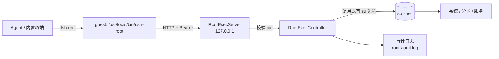
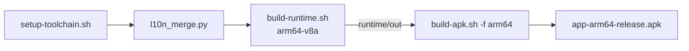

<div align="center">


# DSH Go · Root 增强版

[ccch1mneyyy/dsh-go](https://github.com/ccch1mneyyy/dsh-go) 的非官方二开分支：**让 root 用户在 App 里真正能用 root**，并把 [dsh-purge](https://github.com/kingcharleslzy-ai/dsh-purge) 预装进内置运行时。

原版能力（Ubuntu 环境、模型对话、插件市场、手机控制、遥控电脑等）全部保留，只改 root 相关链路与构建期插件：**内置运行时改由系统 root 解包并 chroot 启动，不再有 PRoot 的假 root。**

<br>

<a href="LICENSE"></a>


<a href="https://github.com/ccch1mneyyy/dsh-go"></a>

<br>

[快速开始](#install) · [首次使用](#first-run) · [Root 增强](#root) · [内置插件](#plugins) · [本地构建](#build) · [常见问题](#faq)

</div>

---

## 🎯 这个分支解决什么问题

原版给 root 留了管道，但实际体验是"连不连都一样"：命令被保活策略、路径白名单、API 34 预检层层挡住，能做的事很窄，Agent 也发现不了这条通道。

本分支把 root 当成一等公民：**环境本身就跑在系统真实 root 下，一次授权之后，App 与内置 CLI 的 root 命令静默执行、全部留痕，Agent 也能自动发现并调用**。

真 root 环境：首次运行时 App 经 `su` 启动一个 uid 0 的 peer 进程，由它解包 rootfs、把文件归属交回 App，再用 `libdshroot-init.so` 执行 `unshare(CLONE_NEWNS)` → 挂载 proc/sysfs、bind /dev 与清单目录 → `chroot` → `execv`。guest 里 `whoami` 就是 `root`，`/proc`、绝对路径、硬链接、inotify 都是真实的。**没有授权时不解包、不启动，也不回退到 PRoot。**

<div align="center">



</div>

---

## ⚖️ 与原版的差异

<a id="diff"></a>

| 方面 | 原版 | 本分支 |
| :--- | :--- | :--- |
| Root 执行 | 预留通道，能力受限、受环境影响 | **通用执行通道**：任意命令、stdout/stderr、超时、后台运行、按 pid 查询与终止 |
| 授权模型 | 逐条确认、多次弹窗 | **一次总授权**，设置页可随时撤销 |
| 留痕 | 无 | 每条命令写入审计日志 `files/root-exec/root-audit.log`（4 MiB 轮转） |
| 后台保活 | 受 API 34 门槛约束 | root 会话**默认保活**；API 34 的额外限制只作用于非 root 路径 |
| 内置插件 | 需自行安装 | **构建期预装** `dsh-purge-community` 1.6.91 + 依赖 `yaml` 2.9.1，装机即用 |
| Agent 支持 | 无 | 内置 `dsh-root` 技能，Agent 自动发现并调用 |
| 出包方式 | 官方签名 / CI | 本地 Linux 构建，可选正式签名（详见构建章节） |

除上表外的行为与上游一致；本分支不改变包名，所以**不能和官方版共存**。

---

## 📱 系统要求

<a id="requirements"></a>

- Android 8.0 及以上，arm64 真机（x86_64 模拟器需自行用 `-f x64` 构建）。
- 内置运行时首次启动会解包（Ubuntu 24.04 + Node + dsh 引擎 + 插件），需要额外存储与几分钟等待，之后才可对话。
- **必需 Root**：内置环境部署在系统真实 root 下（chroot），首次运行必须授予 `su`（Magisk / KernelSU / APatch 均可）；未授权时不会解包，也不会启动任何组件。

---

## 📦 安装

<a id="install"></a>

仓库**不提供预编译 APK**，你需要先在一台 x86_64 Linux 上构建（命令见「本地构建」），得到：

```text
app/build/app/outputs/flutter-apk/app-arm64-release.apk
```

然后任选一种方式装到手机：

```bash
# 方式一：adb（推荐，能看到失败原因）
adb install -r app-arm64-release.apk

# 方式二：拷到手机后用文件管理器 / 安装器打开，允许「未知来源」即可
```

装完后首次启动按引导完成初始化（解包运行时、选择模型与端点、同意必要权限）。

### ✍️ 签名与覆盖安装

> [!WARNING]
> - 未配置 `app/android/key.properties` 时，构建出的 release 包用**打包机的 debug key** 签名：能装能测，但不能覆盖官方签名版，也不能上架。
> - 包名与官方版相同，**签名不同就无法共存**。手机上已有官方版时，先卸载再装；卸载会清空对话、Linux 环境与设置。
> - 之后升级本分支的新包，只要签名不变就能直接覆盖安装，数据保留。

> [!NOTE]
> **卸载**：在系统里正常卸载即可。root 授权、审计日志、运行时数据都在 App 私有目录，会随卸载一起删除。

---

## 🚀 首次使用

<a id="first-run"></a>

1. 启动后按引导选择模型与端点（与原版相同）。
2. 等待内置运行时解包完成，进入对话界面。
3. 需要 root 能力时，按下一节做一次授权即可，不做也不影响其他功能。

---

## 🔓 Root 增强怎么用

<a id="root"></a>

> [!IMPORTANT]
> **前置条件**：手机已 root，且 root 管理器允许给本 App `su`。

1. 打开 **<kbd>设置</kbd> → <kbd>能力</kbd> → <kbd>Root 增强</kbd>**（与「手机控制」同级，不在其子页里）。
2. 点「一次授权」，在 root 管理器里同意 `su` 请求。
3. 页面会显示 `已授权 / 已连接 / 当前 uid / 桥接端口`；点「自检」，返回 `uid=0` 即成功。
4. 之后 Agent 或你自己都可以直接执行命令：

```bash
# 前台执行：返回退出码与输出
dsh-root id -u
dsh-root -c /data/local/tmp ls -l    # -c / --cwd：先切工作目录再执行
dsh-root -t 5000 sleep 1             # -t / --timeout：超时毫秒数（上限 25000）

# 后台执行：立即拿到 pid 与日志路径
dsh-root -d 'logcat -c; logcat > /data/local/tmp/agent.log'
dsh-root --poll 12345
dsh-root --kill 12345

# 状态与自检
dsh-root --status
dsh-root --self-test
```

`dsh-root` 位于运行时内 `/usr/local/bin/dsh-root`；Agent 通过内置 `dsh-root` 技能调用它，在内置终端里也可以直接敲。

### 🚧 边界（硬限制，不是建议）

- 前台单条命令默认 20 s、上限 25 s；超时返回退出码 `124`。
- 后台任务最多 8 个，超出直接报错。
- 单次输出截断到 256 KiB。
- 桥接只监听 `127.0.0.1`；请求需带 Bearer 令牌并校验调用方 uid，令牌由引擎环境注入、不落盘。
- 在设置页撤销授权后，通道立即失效。

---

## 🧩 内置插件 dsh-purge

<a id="plugins"></a>

| 项目 | 值 |
| :--- | :--- |
| 包 | `dsh-purge-community` **1.6.91**（MIT） |
| 依赖 | `yaml` **2.9.1**（ISC/MIT） |
| 安装位置 | `/opt/dsh-go/plugins/dsh-purge-community`，依赖在 `/opt/dsh-go/plugins/node_modules/yaml` |
| 校验 | 构建时从上游 Release / npm 下载，按 `runtime/locks/bundled-plugins.json` 的 sha256 校验后才解包；校验不过构建直接中止 |
| 确认已装 | 设置 → 插件 能看到；或在 guest 里 `ls /opt/dsh-go/plugins` |

> [!NOTE]
> 预装发生在 `runtime/build-runtime.sh` 构建运行时阶段，**不是**装完 App 再下载。要换版本就改 `runtime/locks/bundled-plugins.json`（name / version / url / sha256），再重新构建运行时。

---

## 🛠️ 本地构建（Linux）

<a id="build"></a>

> [!TIP]
> 环境：x86_64 Linux（Ubuntu 22.04 / 24.04 实测），需要 `bash`、`python3`、`curl`、`unzip`、`xz`；**不需要 root**（工具链装在 `~/dev`）；建议预留 15 GB 以上磁盘。

```bash
# 0) 克隆
git clone https://github.com/AtT6669/dsh-go-root && cd dsh-go-root

# 1) 一次性安装工具链：JDK 17 + Flutter 3.47.7 + Android SDK / NDK
bash tooling/setup-toolchain.sh
source tooling/env.sh

# 2) 生成多语言输出（app/lib/l10n/gen 是构建输入，不能省）
python3 app/tool/l10n_merge.py

# 3) 构建 PRoot 运行时（Ubuntu + Node + dsh 引擎 + 内置 dsh-purge）
bash runtime/build-runtime.sh arm64-v8a

# 4) 打包（脚本会用 aapt2 回读 versionName / versionCode 核对）
bash tooling/build-apk.sh -f arm64
```

可选参数：`-f x64`（模拟器）、`--build-number N`、`--build-name X.Y.Z`、`--dry-run`、`--keep-daemon`、`-- --dart-define=K=V`。

失败重跑是安全的，已下载的输入缓存在 `runtime/.cache/`。几个常见坑：

- 第 3 步只能在 Linux 上跑；`runtime/out/<abi>` 缺失时 release 打包会被 `tooling/check_runtime_bundle.py` 拒绝（`--debug` 会跳过校验，但装上也用不了 root 与内置插件）。
- 上游删档已内建兜底：Termux 的 `proot` 等组件随仓库放在 `runtime/vendor/`（离线可用、仍按 sha256 校验）；Ubuntu 的 deb 锁被镜像撤下时会自动按当前索引重解析并提示提交 `runtime/locks/` 的变动。
- 配了代理时 `build-apk.sh` 会把 `HTTPS_PROXY` / `ALL_PROXY` 转给 Gradle，无需手改 `gradle.properties`。
- 想用正式签名：在 `app/android/key.properties` 写 `storeFile` / `storePassword` / `keyAlias` / `keyPassword`（`chmod 600`），重新打包即可。

<div align="center">



</div>

完整的步骤、签名、产物验收与排错见 **[docs/maintenance/local-build.md](docs/maintenance/local-build.md)**。

---

## 🩺 常见问题

<a id="faq"></a>

| 现象 | 原因与处理 |
| :--- | :--- |
| 安装报「应用未安装」/ 签名冲突 | 手机上还有同包名的官方签名版，先卸载官方版再装 |
| 升级后数据没了 | 两次打包签名不同，系统只能卸载重装；保持同一份 `key.properties` |
| Root 增强页显示已授权但命令失败 | 先在 root 管理器里确认 App 拿到 `su`；再点自检看 `uid`；仍失败查看审计日志 |
| 设置里找不到 Root 增强 | 只有 Android 8+ 可见；确认装的是本分支而不是官方版 |
| 插件里看不到 dsh-purge | 说明装的 APK 没有内置运行时（多为 `--debug` 包），用 release 包重装 |
| 首次启动卡在解包 | 存储不足或被系统冻结；留足空间后重试，不必重装 |

审计日志位于 App 私有目录 `files/root-exec/root-audit.log`（读取需要 root）。

---

## 🗂️ 仓库结构（只列与本分支相关的部分）

<a id="layout"></a>

```text
app/                     Flutter 客户端
  android/app/src/main/kotlin/.../phone/background/RootExec*.kt   root 通道与服务端
  android/app/src/main/kotlin/.../root/RootExecServer.kt          loopback HTTP 桥
  lib/ui/phone/root_exec_page.dart                               Root 增强设置页
runtime/                 PRoot 运行时构建
  build-runtime.sh       入口（PIN 表、层级、内置插件）
  vendor/                易被上游删除的输入（Termux deb、proot 源码）
  root-exec/dsh-root.mjs guest 侧 CLI
  skills/dsh-root/       Agent 技能
  locks/                 deb 与插件锁文件
tooling/                 构建与检查脚本（setup-toolchain / build-apk / check_runtime_bundle）
docs/                    设计、维护、使用指南
```

---

## 📚 文档

<a id="docs"></a>

| 文档 | 内容 |
| :--- | :--- |
| [docs/maintenance/local-build.md](docs/maintenance/local-build.md) | 打包：Linux 本地出包、签名、验收与排错 |
| [docs/guide/zh/13-root.md](docs/guide/zh/13-root.md) | 使用指南：Root 增强一章 |
| [docs/design/root-exec.md](docs/design/root-exec.md) | 设计：通道拓扑、四个操作、限额与失败语义 |
| [docs/maintenance/root-exec-contract.md](docs/maintenance/root-exec-contract.md) | 维护：CLI 与桥接的契约（改协议前必读） |
| [docs/design/bundled-plugins.md](docs/design/bundled-plugins.md) | 设计：构建期预装与锁文件 |
| [docs/guide/README.md](docs/guide/README.md) | 原版完整使用指南（仍适用） |

---

## ⚠️ 风险提示

<a id="risk"></a>

> [!CAUTION]
> Root 权限意味着任何命令都能改系统分区、框架与数据。本分支的「一次授权 + 审计日志 + 限额」只是降低误操作与滥用概率，**不构成安全保证**：

- 授权即等于把整台手机的写权限交给 App 及其 Agent；
- 审计日志只记录、不阻止，泄漏或被清空由你自行负责；
- 不要在含支付、银行、企业数据的主力机上随手授权。

使用本软件即表示你理解并自担上述风险。

---

## 🔗 与上游的关系

<a id="upstream"></a>

- 上游：`ccch1mneyyy/dsh-go`（作者 ccch1mneyyy）。本项目是**非官方**二开，不代表上游立场，也不要向上游报本分支的问题。
- 许可证继承上游 **AGPL-3.0**：本分支的修改同样以 AGPL-3.0 发布，分发二进制时须一并提供对应源码（含 `runtime/vendor/` 内 proot 的 GPL-2.0 源码归档）。
- 内置的 `dsh-purge` 为 MIT，`yaml` 为 ISC/MIT，版权归各自作者。

<div align="center">

<br>


Made with PRoot · Flutter · dsh ｜ 上游 [ccch1mneyyy/dsh-go](https://github.com/ccch1mneyyy/dsh-go)

</div>
